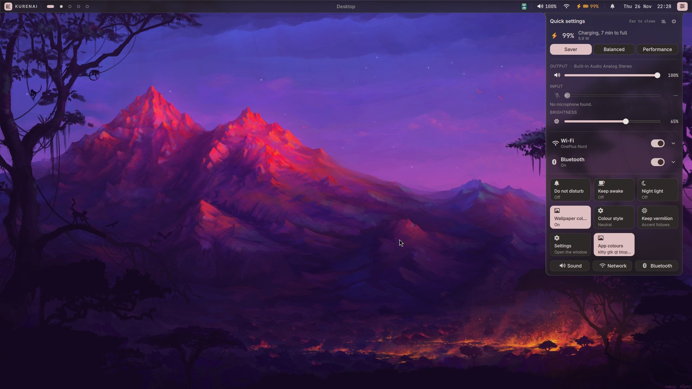
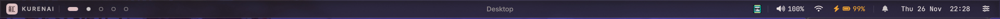
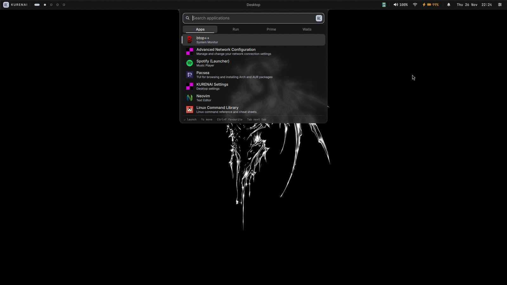
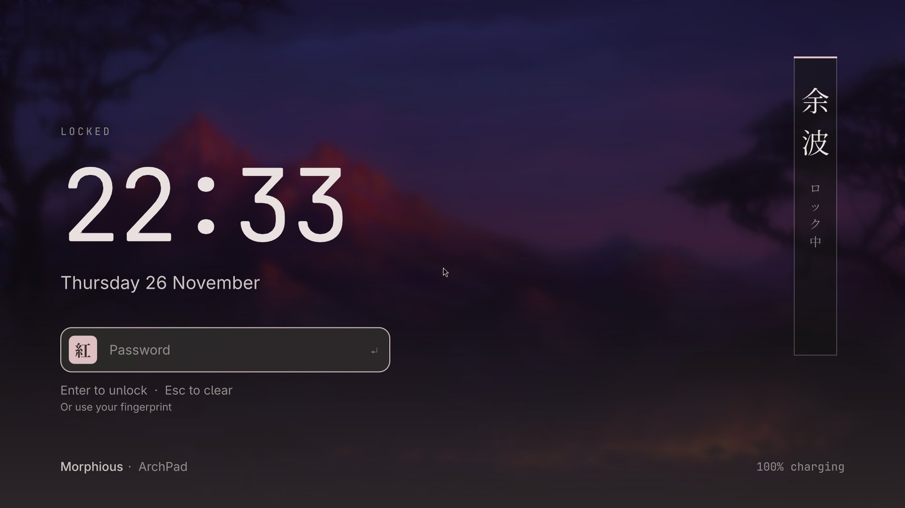
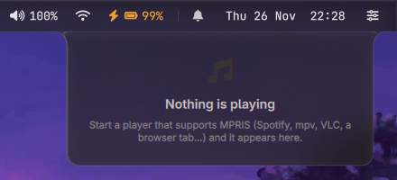
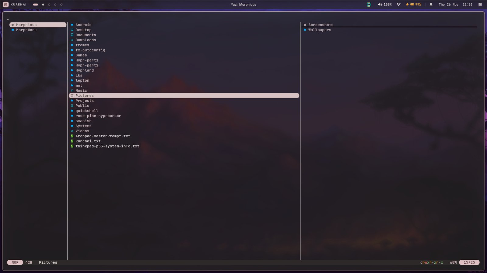
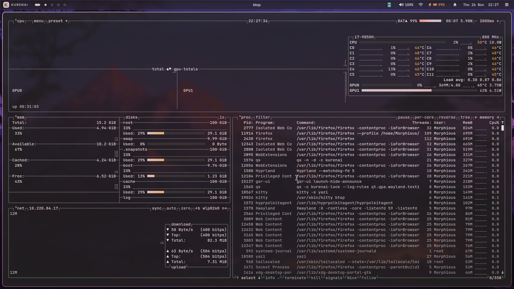
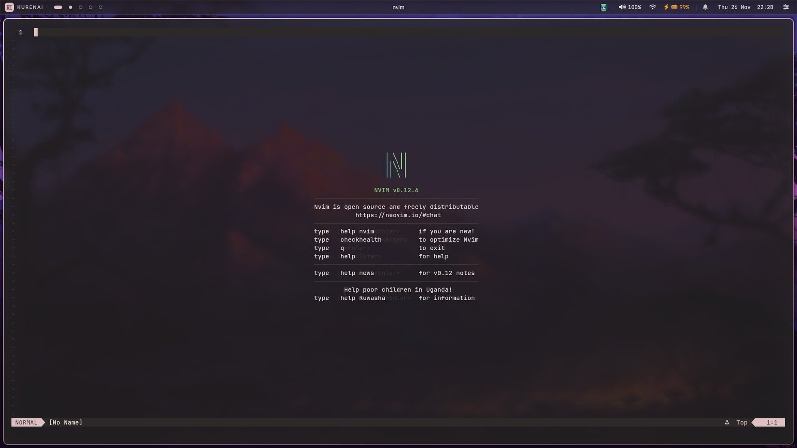
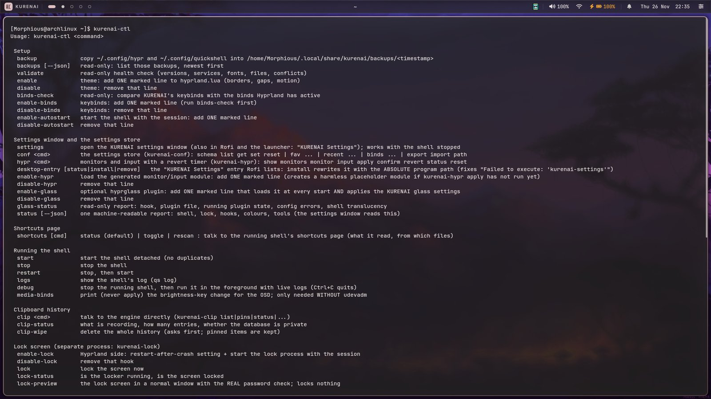

<div align="center">

# 紅 KURENAI

**A wallpaper-driven desktop shell for Hyprland, built on Quickshell.**

Bar, launcher, quick settings, notifications, clipboard history, lock screen and a full settings app, all in one coherent crimson-and-ink design that recolours itself (and your terminal, GTK and Qt apps) from your wallpaper.

-58E1FF?style=flat-square)




</div>

---

> [!NOTE]
> **This project was made with the help of artificial intelligence.**
> The design and code were developed in collaboration with AI tools, directed and tested by the author on real hardware. It works on my machine, but it has not been tested on other setups. Read the scripts before you run them, keep a backup, and expect rough edges. Issues and pull requests are welcome.
<!-- TODO: name the AI tools/models used if you want to credit them specifically. -->

## Contents

- [Features](#features)
- [Screenshots](#screenshots)
- [Platform and compatibility](#platform-and-compatibility)
- [Requirements](#requirements)
- [Installation](#installation)
- [Usage](#usage)
- [The `kurenai-ctl` command](#the-kurenai-ctl-command)
- [Uninstall and rollback](#uninstall-and-rollback)
- [Troubleshooting](#troubleshooting)
- [Credits](#credits)
- [License](#license)

## Features



- **Top bar** with the KURENAI menu, workspace indicators, the focused window title in the centre, and a status area for screen recorder, volume, Wi-Fi, battery, notifications, clock and quick settings.
- **Launcher** with four tabs: **Apps**, **Run** (commands), **Prime** (launch apps on the NVIDIA GPU on hybrid-graphics laptops) and **Walls** (wallpaper switcher with previews). Favourites with `Ctrl+F`.
- **Quick settings panel** with power profiles (Saver / Balanced / Performance), volume, microphone and brightness sliders, Wi-Fi and Bluetooth toggles, Do not disturb, Keep awake and Night light.
- **Wallpaper-driven colours.** Pick a wallpaper and the shell recolours itself. Optional "App colours" extend the palette to other apps (kitty, GTK, Qt, btop and more). Choose the colour style and pin the vermilion accent if you want it to stay put.
- **Settings app** (`kurenai-ctl settings`) for everything: colours, wallpaper, launcher, Rofi, bar and panels, notifications, clipboard, keybinds, startup, lock screen, display and input, backup and restore, logs and checks.
- **Media widget** for anything that speaks MPRIS (Spotify, mpv, VLC, browser tabs).
- **Notification centre** and a **clipboard history** (pinned items survive wipes).
- **Keyboard shortcuts page** that reads your actual Hyprland config files, lists every bind, and checks them against what Hyprland has active.
- **Lock screen** (`kurenai-lock`) with password and fingerprint support, and a safe preview mode that locks nothing.
- **Reversible by design.** Every change KURENAI makes to your Hyprland config is a single marked line that `kurenai-ctl` can add or remove, and there is a one-command backup.
- **Optional Rofi launcher** and an optional `hyprglass` Hyprland plugin integration for translucent windows.
<!-- TODO: add a link to the hyprglass plugin repo you use, and list it under Optional requirements. -->

## Screenshots

<table>
  <tr>
    <td width="50%"><br><sub><b>Launcher: Apps</b></sub></td>
    <td width="50%"><br><sub><b>Launcher: Prime</b> (run on the NVIDIA GPU)</sub></td>
  </tr>
  <tr>
    <td width="50%"><br><sub><b>Launcher: Walls</b> (wallpaper switcher)</sub></td>
    <td width="50%"><br><sub><b>Keyboard shortcuts</b>, read from your real config</sub></td>
  </tr>
  <tr>
    <td width="50%"><br><sub><b>KURENAI Settings</b></sub></td>
    <td width="50%"><br><sub><b>Lock screen</b></sub></td>
  </tr>
</table>

**Media widget**



**Your apps follow the palette** (kitty running yazi, btop and Neovim)

<table>
  <tr>
    <td width="33%"></td>
    <td width="33%"></td>
    <td width="33%"></td>
  </tr>
</table>

## Platform and compatibility

| | |
|---|---|
| **Distribution** | Arch Linux (and Arch-based distributions that ship current Arch packages) |
| **Compositor** | [Hyprland](https://hypr.land) **0.55 or newer**, using the **Lua configuration** (`hyprland.lua`). The old `hyprland.conf` (hyprlang) format is not what this project targets. |
| **Shell toolkit** | [Quickshell](https://quickshell.org) (`qs`), Qt 6 / QML |
| **Session** | Wayland only |
| **Developed on** | ThinkPad P53, Intel + NVIDIA hybrid graphics, 1920×1080 display, PipeWire audio |

KURENAI is built around a single laptop setup. Desktops, multi-monitor layouts, AMD-only or Intel-only systems and non-Arch distributions may need adjustments. The **Prime** tab only makes sense on hybrid-graphics machines.
<!-- TODO: confirm "Developed on" details and add anything you have since tested. -->

## Requirements

Install from the official repositories unless noted. Review any AUR `PKGBUILD` before you build it.

**Required**

| Package | Why |
|---|---|
| `hyprland` (0.55+) | The compositor. Lua configuration support is required. |
| `quickshell` | Runs the shell (`qs -c kurenai`). Available in the `extra` repository. |
| `kitty` | Default terminal, also used for the file manager and system monitor binds. |
| `hyprpolkitagent` | Polkit authentication prompts. |
| `xdg-desktop-portal-hyprland`, `xdg-desktop-portal-gtk` | Screen sharing and file dialogs. |

**System services the panels talk to** (needed for the matching feature to work)

| Feature | Typical package |
|---|---|
| Audio, volume and sound output | `pipewire`, `pipewire-pulse`, `wireplumber` |
| Wi-Fi and network panel | `networkmanager` (`nm-connection-editor` for the advanced network window) |
| Bluetooth | `bluez`, `bluez-utils` |
| Power profiles (Saver / Balanced / Performance) | `power-profiles-daemon` |
| Battery | `upower` |
| Brightness keys and on-screen display | Works through `udevadm`; if the OSD does not react, see `kurenai-ctl media-binds` |
| Fingerprint unlock | `fprintd` |
<!-- TODO: verify each row against what the shell actually calls, and delete or correct any that are wrong. `kurenai-ctl validate` is the source of truth. -->

**Optional**

| Package | Why |
|---|---|
| `rofi` | Alternative launcher (`Super+Alt+Space`) |
| `yazi`, `btop`, `neovim` | The apps bound to `Super+E`, `Super+Shift+Esc` and used in the screenshots |
| `gpu-screen-recorder` | Screen recorder shown in the bar |
| `nvidia-prime` (provides `prime-run`) | Prime tab on NVIDIA hybrid laptops |
| `firefox`, `spotify-launcher` | Default browser and music binds |
<!-- TODO: add the fonts and the wallpaper-colour generator (for example matugen) that KURENAI uses, with package names. `kurenai-ctl validate` also checks fonts. -->

## Installation

> [!WARNING]
> KURENAI edits files under `~/.config/hypr` and `~/.config/quickshell`, and it can replace your lock screen. **Back up first** and test the lock screen in preview mode before enabling it. Keep a spare TTY (`Ctrl+Alt+F3`) available the first time you try it.

**1. Install the dependencies**

```bash
sudo pacman -S --needed hyprland quickshell kitty hyprpolkitagent \
  xdg-desktop-portal-hyprland xdg-desktop-portal-gtk
# then whichever optional and service packages from the tables above you want
```

**2. Back up your current config**

```bash
cp -a ~/.config/hypr ~/.config/hypr.bak
[ -d ~/.config/quickshell ] && cp -a ~/.config/quickshell ~/.config/quickshell.bak
```

**3. Get KURENAI**

```bash
git clone https://github.com/YOUR-USERNAME/kurenai.git
cd kurenai
```

**4. Copy the files into place**

```bash
mkdir -p ~/.config/quickshell ~/.local/bin
cp -r quickshell/kurenai ~/.config/quickshell/
cp -r hypr/* ~/.config/hypr/          # only the KURENAI modules, review before overwriting
install -m755 bin/kurenai-* ~/.local/bin/
```
<!-- TODO: replace step 4 with the real repository layout. The paths above are an assumption (shell in quickshell/kurenai, helper scripts kurenai-ctl, kurenai-conf, kurenai-clip, kurenai-hypr, kurenai-settings, kurenai-sysmon and kurenai-lock-supervisor in bin/). Also state whether ~/.local/bin must be on PATH. -->

Make sure `~/.local/bin` is on your `PATH`.

**5. Check your system**

```bash
kurenai-ctl validate
```

This is a read-only health check of versions, services, fonts, files and conflicts. Fix anything it reports before continuing.

**6. Hook KURENAI into Hyprland**

Each of these adds **one marked line** to your Hyprland config and can be removed again with the matching `disable-*` command.

```bash
kurenai-ctl enable             # theme: borders, gaps, motion
kurenai-ctl binds-check        # read-only: compare KURENAI keybinds with what Hyprland has active
kurenai-ctl enable-binds       # KURENAI keybinds
kurenai-ctl enable-autostart   # start the shell with your session
kurenai-ctl enable-hypr        # monitor and input module (optional)
```

**7. Lock screen (do this carefully)**

```bash
kurenai-ctl lock-preview       # shows the lock screen in a normal window with the real password check; locks nothing
kurenai-ctl enable-lock        # only once the preview works
```

**8. Start it**

```bash
kurenai-ctl start
kurenai-ctl settings           # open the settings app
```

Optional: `kurenai-ctl desktop-entry install` adds a working "KURENAI Settings" entry to your launcher, and `kurenai-ctl enable-glass` enables the optional hyprglass integration.

## Usage

**Default keybinds** (the full list lives on the Shortcuts page, `kurenai-ctl shortcuts toggle`)

| Keys | Action |
|---|---|
| `Super` + `Space` | Application launcher |
| `Super` + `Shift` + `R` | Run a command (launcher) |
| `Super` + `Shift` + `P` | Apps on the NVIDIA GPU (launcher) |
| `Super` + `Shift` + `W` | Wallpaper switcher |
| `Super` + `Alt` + `Space` | Rofi |
| `Super` + `T` | Terminal (kitty) |
| `Super` + `E` | File manager (yazi in kitty) |
| `Super` + `Shift` + `Esc` | System monitor (btop in kitty) |
| `Super` + `W` | Firefox |
| `Super` + `Alt` + `M` | spotify-launcher |

Inside the launcher: `Enter` launches, `↑`/`↓` moves, `Ctrl+F` toggles a favourite and `Tab` switches tab. In the Walls tab, `Shift+Enter` sets a wallpaper and keeps the launcher open, and `Ctrl+E` previews it.

**Colours.** Open quick settings and use *Wallpaper colours*, *Colour style*, *Keep vermilion* and *App colours*, or go to **Settings → Colours / App colours**. Settings are stored by `kurenai-conf` and can be exported and imported.

## The `kurenai-ctl` command

`kurenai-ctl` is the control tool for the whole shell.

| Command | What it does |
|---|---|
| `start` / `stop` / `restart` | Run the shell detached (no duplicates), stop it, or restart it |
| `logs` / `debug` | Show the shell log, or run it in the foreground with live logs |
| `validate` | Read-only health check |
| `status [--json]` | Machine-readable report of shell, lock, hooks, colours and tools |
| `backup` / `backups` | Copy `~/.config/hypr` and `~/.config/quickshell` into `~/.local/share/kurenai/backups/<timestamp>`, or list backups |
| `enable` / `disable` | Add or remove the theme line in `hyprland.lua` |
| `binds-check` | Compare KURENAI keybinds with the binds Hyprland has active |
| `enable-binds` / `disable-binds` | Add or remove the keybinds line |
| `enable-autostart` / `disable-autostart` | Start the shell with the session, or stop doing so |
| `enable-hypr` / `disable-hypr` | Load the generated monitor and input module |
| `enable-glass` / `disable-glass` / `glass-status` | Optional hyprglass integration |
| `settings` | Open the settings window (works with the shell stopped) |
| `conf <cmd>` | Settings store: `schema list get set reset`, `fav`, `recent`, `binds`, `export import path` |
| `hypr <cmd>` | Monitors and input with a revert timer: `show monitors monitor input apply confirm revert status reset` |
| `shortcuts [status\|toggle\|rescan]` | Talk to the shortcuts page |
| `clip <cmd>`, `clip-status`, `clip-wipe` | Clipboard history engine, status, and wipe (pinned items are kept) |
| `lock`, `lock-status`, `lock-preview`, `enable-lock`, `disable-lock` | Lock screen control |
| `desktop-entry [status\|install\|remove]` | Manage the "KURENAI Settings" launcher entry |

<details>
<summary>Screenshot of <code>kurenai-ctl</code> help</summary>



</details>

## Uninstall and rollback

Every hook is reversible:

```bash
kurenai-ctl disable-lock
kurenai-ctl disable-autostart
kurenai-ctl disable-binds
kurenai-ctl disable-hypr
kurenai-ctl disable-glass
kurenai-ctl disable
kurenai-ctl stop
```

To restore your previous config, copy the backup back (`~/.config/hypr.bak` from the install steps, or any folder under `~/.local/share/kurenai/backups/`), then restart Hyprland. Remove `~/.config/quickshell/kurenai` and the `kurenai-*` scripts to remove KURENAI completely.

## Troubleshooting

- **Nothing shows up after install.** Run `kurenai-ctl validate`, then `kurenai-ctl debug` to see live logs.
- **"Failed to execute: 'kurenai-settings'" in Rofi.** Run `kurenai-ctl desktop-entry install`, which rewrites the entry with the absolute program path.
- **Keybinds do nothing.** Run `kurenai-ctl binds-check` to see which binds Hyprland has active and which conflict.
- **Brightness keys or slider do not work.** See `kurenai-ctl media-binds`, which prints the needed change. It is only required when you are not using `udevadm`.
- **Hyprland config errors.** Run `hyprctl configerrors`. This project needs the Lua config that arrived in Hyprland 0.55.
- **Locked out.** Switch to a TTY (`Ctrl+Alt+F3`), log in, and run `kurenai-ctl disable-lock`.

## Credits

- [Hyprland](https://hypr.land), by Vaxry and contributors.
- [Quickshell](https://quickshell.org), by outfoxxed and contributors.
- Wallpapers in the screenshots are third-party artwork and are **not** included in this repository. All rights belong to their respective artists.
<!-- TODO: credit the wallpaper artist(s) for the mountain/sunset image used in most screenshots, plus any fonts, icons or code you borrowed from other projects. -->
- Designed and written with the help of artificial intelligence.

## License

<!-- TODO: choose a license (MIT, GPL-3.0, etc.), add a LICENSE file, and replace this line. Without a license file, others have no permission to reuse the code. -->
License not yet specified.
