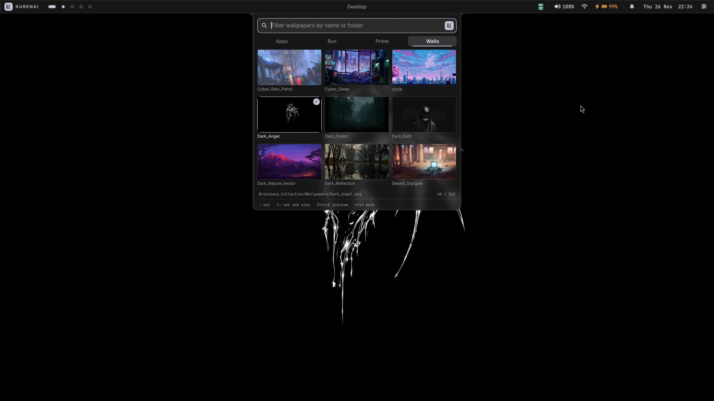
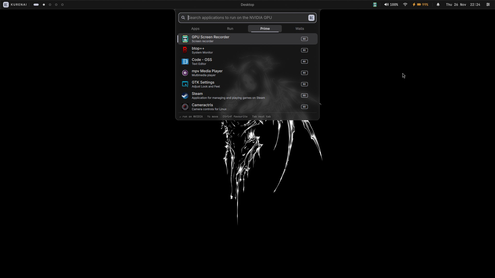
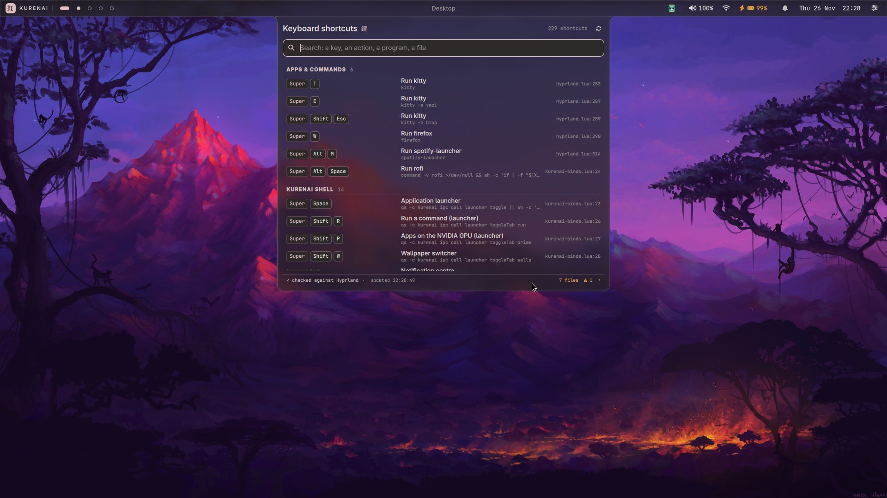
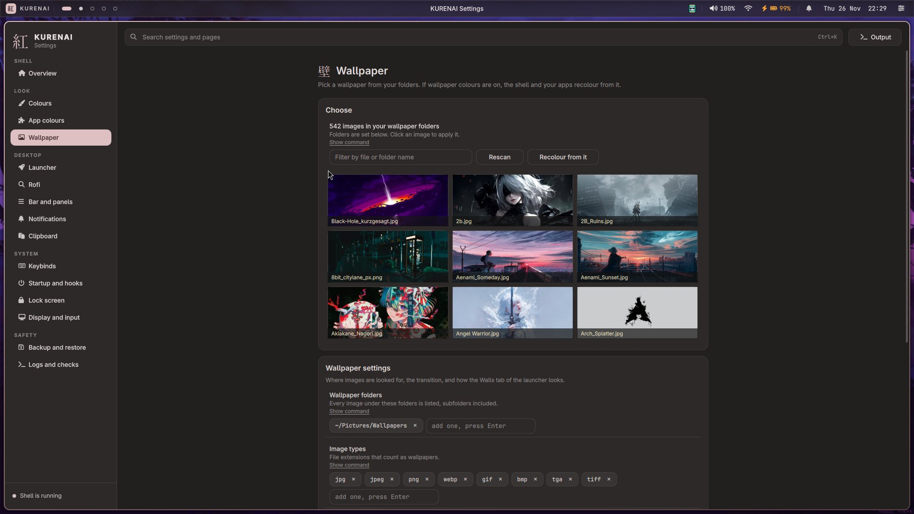
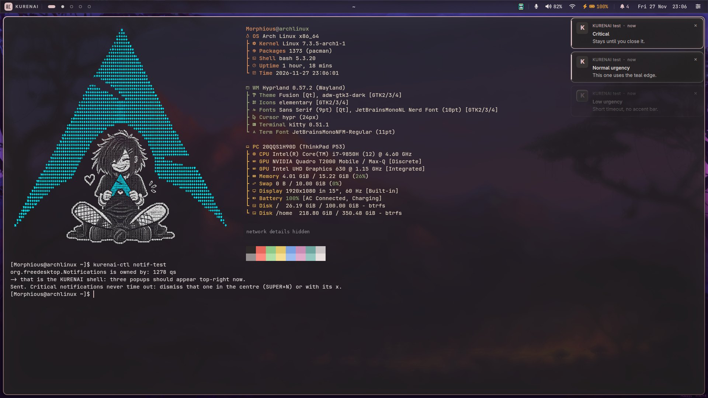
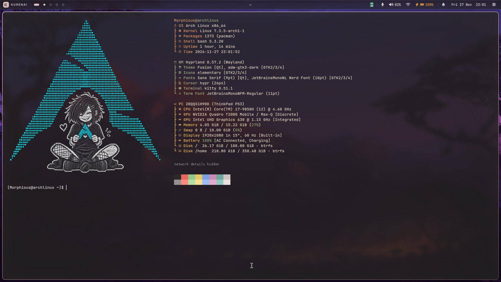
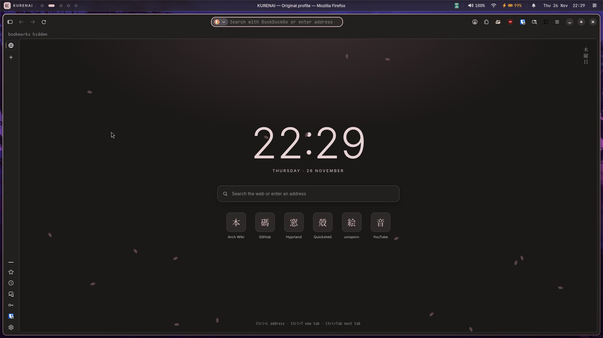
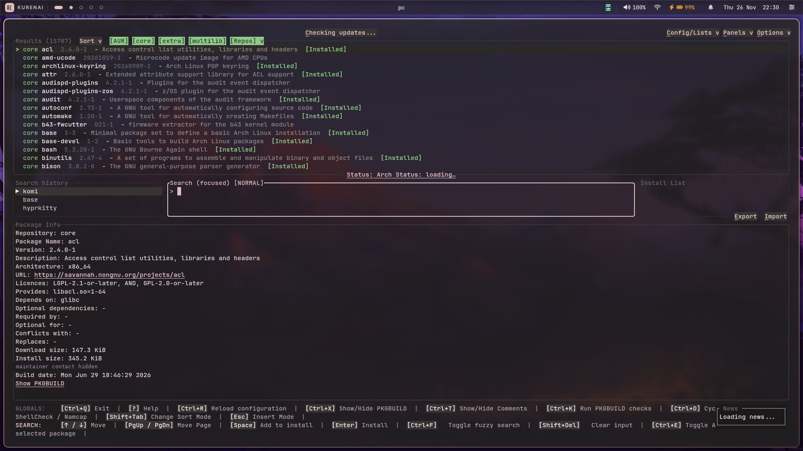
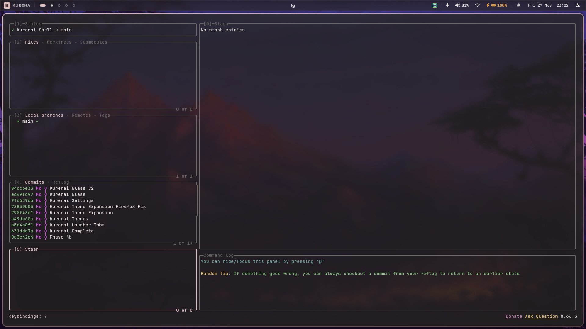

<div align="center">

<h1>紅 &nbsp;KURENAI</h1>

<p><b>A Japanese, anime-inspired desktop shell for Hyprland, built on Quickshell.</b><br>
Vermilion on charcoal. Bone-white type. One look from the bar to the lock screen.</p>

<p>
  
  
  
  
</p>


</div>

> [!IMPORTANT]
> **This project was made with the help of artificial intelligence.**
> The design direction, the testing on a real machine and the decisions are the author's. The code, the scripts and the documentation
> were written with **Claude** (an AI assistant made by Anthropic). Treat it like any other config you download:
> read before you run, and keep the backups the installer makes. See [What is tested and what is not](#what-is-tested-and-what-is-not) for what was and was not run.

---

## At a glance

| | |
|---|---|
| **What it is** | A complete desktop shell: top bar, notifications, launcher, quick settings, media, calendar, clipboard history, system monitor, power menu, shortcuts page, lock screen and a Settings app |
| **Platform** | **Arch Linux** (or an Arch-based distro), **Wayland**, **Hyprland 0.55 or newer** using the new **Lua** config |
| **Built on** | [Quickshell](https://quickshell.org) (QML). No Waybar, no eww, no GTK shell |
| **Written and used on** | ThinkPad P53, hybrid Intel UHD 630 + NVIDIA Quadro T2000, SDDM, PipeWire, NetworkManager, kitty |
| **Screenshots** | Hyprland 0.57.2, kitty 0.51.1 |
| **Safe by design** | `install.sh` backs up first and starts nothing. Every step after it is a separate command you choose to run, and each one can be undone |
| **Kept as is** | Your `hyprland.lua` is never replaced (KURENAI adds single marked lines), and **Rofi stays** as the fallback launcher |

---

## Look

<table>
<tr>
<td width="50%"><br><sub><b>Launcher</b>: Apps, Run, Prime and Walls tabs. <code>SUPER + SPACE</code></sub></td>
<td width="50%"><br><sub><b>Walls tab</b>: thumbnails of every wallpaper in your folder; Enter sets one</sub></td>
</tr>
<tr>
<td width="50%"><br><sub><b>Prime tab</b>: start an app on the NVIDIA GPU with <code>prime-run</code></sub></td>
<td width="50%"><br><sub><b>Shortcuts page</b>: reads your real config, so it can never go stale. <code>SUPER + /</code></sub></td>
</tr>
<tr>
<td width="50%"><br><sub><b>Lock screen</b>: its own process, password or fingerprint, a vertical 余波 tag</sub></td>
<td width="50%"><br><sub><b>Settings app</b>: 15 pages; every control can show the command it runs</sub></td>
</tr>
<tr>
<td width="50%"><br><sub><b>Notifications</b>: critical stays until dismissed, normal and low time out</sub></td>
<td width="50%"><br><sub><b>Terminal</b>: kitty recoloured to match (fastfetch)</sub></td>
</tr>
<tr>
<td width="50%"><br><sub><b>Firefox</b> (opt-in): tab rail, start page, detached launcher card</sub></td>
<td width="50%"><br><sub><b>Pacsea</b> themed (one of the app colours)</sub></td>
</tr>
<tr>
<td colspan="2" align="center"><br><sub><b>lazygit</b> themed</sub></td>
</tr>
</table>

<sub>Network names, IP addresses, locations and bookmark titles were removed from these screenshots before publishing. The wallpapers are other people's artwork and are **not** part of this repository.</sub>

---

## What you get

| Piece | What it does |
|---|---|
| **Bar** | KURENAI emblem, workspace dots that follow Hyprland, window title, clock, tray, volume, Wi-Fi, battery, notification bell |
| **Quick settings** | Power profile (Saver / Balanced / Performance), output / input / brightness sliders, Wi-Fi and Bluetooth, Do Not Disturb, Keep awake, Night light, Wallpaper colours, Colour style, Settings. `SUPER + A` |
| **Notifications** | Popups, a history centre, Do Not Disturb. One shared state. `SUPER + N` |
| **Launcher** | **Apps** (with favourites), **Run** (commands, with history), **Prime** (NVIDIA GPU), **Walls** (wallpapers). `SUPER + SPACE` |
| **Media, calendar, OSD** | An MPRIS panel, a month calendar, a pill for volume / brightness / mic |
| **Clipboard history** | `cliphist` front-end with pins and one-key wipe. `SUPER + V` |
| **System monitor** | Read-only CPU / memory / disk / temperature snapshot. `SUPER + I` |
| **Shortcuts page** | Every shortcut in your Hyprland config, searchable, and checked against what Hyprland says is bound. `SUPER + /` |
| **Power menu** | Lock, log out, reboot, shut down; the destructive ones need a second click. `SUPER + ESC` |
| **Lock screen** | A separate process with a crash supervisor, password and optional fingerprint |
| **Settings app** | 15 pages: Overview, Colours, App colours, Wallpaper, Launcher, Rofi, Bar and panels, Notifications, Clipboard, Keybinds, Startup and hooks, Lock screen, Display and input, Backup and restore, Logs and checks |
| **Wallpaper colours** | [matugen](https://github.com/InioX/matugen) recolours the shell, lock screen, Rofi and window borders from your wallpaper |
| **App colours** | kitty, GTK, Qt, btop, yazi, zathura, Neovim, Spicetify, Pacsea, lazygit and Firefox can follow the same palette, each one only when you attach it |
| **Glass** (optional, experimental) | Blur and edge light behind translucent panels, through the [hyprglass](https://github.com/hyprnux/hyprglass) plugin |

Everything optional degrades on its own: a missing tool hides or explains that one control instead of breaking the shell.

---

## Requirements

### Platform

- **Arch Linux** or an Arch-based distribution with `pacman`
- **Wayland**, with **Hyprland 0.55 or newer** (the Lua config format). Check with `hyprctl version`
- **Quickshell** (`qs --version`)
- A display manager or TTY login that starts Hyprland. SDDM was used here
- Another distro may work, but package names and paths were only checked on Arch

### Packages

Check any name first with `pacman -Si NAME`. If pacman says "not found", that package is not in your enabled repositories and
is probably in the AUR: read its PKGBUILD before building it.

**Required**

```bash
sudo pacman -S hyprland quickshell
```

**Strongly recommended** (fonts; without them the look falls back to defaults)

```bash
sudo pacman -S adwaita-fonts ttf-jetbrains-mono-nerd noto-fonts-cjk
```

**Services most desktops already run** (used directly by Quickshell): PipeWire + WirePlumber (audio), NetworkManager (Wi-Fi), BlueZ (Bluetooth), UPower (battery).

**Optional, grouped by what they unlock**

| Feature | Packages |
|---|---|
| Fallback launcher (**keep this**) | `rofi` |
| Wallpapers: set, and the Walls tab | `awww` |
| Wallpaper colours | `matugen` |
| Brightness, power profiles, night light | `brightnessctl`, `power-profiles-daemon`, `hyprsunset` |
| Clipboard history | `cliphist`, `wl-clipboard`, `xdg-utils` |
| Lock on idle, fingerprint | `hypridle`, `fprintd` |
| NVIDIA Prime tab (hybrid laptops) | `nvidia-prime` (provides `prime-run`) |
| Media keys, test notifications | `playerctl`, `libnotify` |
| Shortcuts in quick settings | `nm-connection-editor`, `pwvucontrol` or `pavucontrol`, `blueman` or `overskride` |
| Graceful log out | `hyprshutdown` |
| App colours (attach any of these) | `adw-gtk-theme`, `qt6ct` / `qt5ct`, `kitty`, `btop`, `yazi`, `zathura`, `neovim`, `spicetify`, `pacsea`, `lazygit`, `firefox` |
| Glass effects | the `hyprglass` plugin, built with `hyprpm` (see [Glass](#glass-optional-and-experimental)) |

`kurenai-ctl validate` checks all of the above, read-only, and prints `[ ok ]`, `[warn]`, `[FAIL]` or `[ -- ]` (optional tool not installed) for each.

---

## Install

> Nothing here needs root except the package install. `install.sh` itself never uses `sudo`, never edits your `hyprland.lua`
> and never starts or stops anything. Run the steps one at a time and stop at the first error.

**1. Get it**

```bash
git clone https://github.com/Morphious304/Kurenai-Shell.git
cd Kurenai-Shell
```

**2. Look before you leap (read-only)**

```bash
hyprctl version | head -1
qs --version
ls ~/.config/hypr ~/.config/quickshell 2>/dev/null
```

**3. Install the files** (backs up first, starts nothing)

```bash
bash install.sh
kurenai-ctl validate        # put ~/.local/bin on your PATH if this is "not found"
```

**4. Try it in the foreground.** `Ctrl+C` quits and leaves your desktop as it was.

```bash
kurenai-ctl debug
```

**5. Switch things on, one at a time**

```bash
kurenai-ctl enable              # appearance: one marked line added to hyprland.lua
hyprctl configerrors            # empty means no errors
kurenai-ctl binds-check         # look for clashes first
kurenai-ctl enable-binds        # the 15 KURENAI keybinds
kurenai-ctl notif-takeover      # only one program can own notifications (mako / dunst / swaync are stopped, and remembered)
kurenai-ctl start
kurenai-ctl enable-autostart    # start with the session
```

**6. The lock screen is last, and has its own safe order.** Open a second TTY first (`Ctrl+Alt+F3`) and read
[docs/LOCK-SCREEN.md](docs/LOCK-SCREEN.md). The short version: `lock-preview`, `enable-lock`, `lock-start`, then `lock`.

The long, step-by-step version (with what to expect at each step) is the [full manual](docs/MANUAL.md#3-first-time-install).

### Updating

`install.sh` is safe to re-run. Files you edited are kept or moved aside (never deleted); see the table in the [manual](docs/MANUAL.md#4-updating).

```bash
git pull && bash install.sh && kurenai-ctl validate && kurenai-ctl restart
```

### Undo

| To undo | Run |
|---|---|
| Everything at once: stops the lock screen, hands notifications back, removes every marked line KURENAI added to your Hyprland config, moves its files aside (your Rofi, backups and own files stay) | `kurenai-ctl rollback` |
| Notifications back to the old daemon | `kurenai-ctl notif-restore` |
| Wallpaper colours | `kurenai-ctl theme off` |
| One app colour | `kurenai-ctl theme extra NAME off` |
| Glass | `kurenai-ctl disable-glass` |

Backups of `~/.config/hypr` and `~/.config/quickshell` live in `~/.local/share/kurenai/backups/`.

---

## Daily use

| Keys | Does |
|---|---|
| `SUPER + SPACE` | Launcher (falls back to Rofi if the shell is not running) |
| `SUPER + SHIFT + SPACE` | Rofi directly, with the KURENAI theme |
| `SUPER + SHIFT + R` / `P` / `W` | Launcher on the **Run** / **Prime** / **Walls** tab |
| `SUPER + A` | Quick settings |
| `SUPER + N` / `SUPER + SHIFT + N` | Notification centre / Do Not Disturb |
| `SUPER + C` | Calendar |
| `SUPER + SHIFT + M` | Media panel |
| `SUPER + V` | Clipboard history |
| `SUPER + I` | System monitor |
| `SUPER + /` | **Keyboard shortcuts** (the live list of everything bound) |
| `SUPER + L` | Lock |
| `SUPER + ESC` | Power menu |

Every panel closes with `Esc` or a click outside. The full key tables and the IPC commands (`qs -c kurenai ipc call ...`) are in the [manual](docs/MANUAL.md#5-using-it-shortcuts-and-ipc).
Bound to a key you do not like? Edit `~/.config/hypr/kurenai-binds.lua` or use the **Keybinds** page in Settings.

---

## Make it yours

| To change | How |
|---|---|
| Almost anything, with buttons | open **KURENAI Settings** from the launcher (or run `kurenai-settings`) |
| Colours that follow the wallpaper | quick settings tile **Wallpaper colours**, or `kurenai-ctl theme on` ([docs/THEME.md](docs/THEME.md)) |
| Colours in your apps | `kurenai-ctl theme extras` lists them; `kurenai-ctl theme extra kitty on` attaches one and prints exactly what it changes |
| Firefox | `kurenai-ctl theme extra firefox on` ([docs/FIREFOX.md](docs/FIREFOX.md)) |
| Fonts, sizes, radii, animation speed | `~/.config/quickshell/kurenai/Theme.qml` |
| Behaviour (OSDs, docking, limits, wallpaper folders) | `~/.config/quickshell/kurenai/Config.qml` |
| Window borders, gaps, rounding | `~/.config/hypr/kurenai.lua` |

Quickshell reloads QML when you save, so most edits show up straight away. The palette is vermilion `#F04436`, charcoal `#242424`, bone `#F4E8BE`, with teal and rose as quiet secondaries.

---

## Glass (optional, and experimental)

Blur, a thin edge light and grain behind translucent panels, through the [hyprglass](https://github.com/hyprnux/hyprglass) plugin.
It is **off by default** and the shell looks complete without it.

```bash
hyprpm add https://github.com/hyprnux/hyprglass && hyprpm enable hyprglass     # once, as your user
kurenai-ctl enable-glass          # loads it after Hyprland is ready, with a safety net
kurenai-ctl glass-status          # the one-stop report
kurenai-conf set glassOpacity 72  # how see-through the panels are (100 = solid)
```

> [!WARNING]
> The first version of the glass module loaded the plugin while Hyprland was still reading its config, and on the author's machine
> that froze the whole system. The current version loads it afterwards and, if a start with glass does not survive 30 seconds,
> **switches glass off by itself on the next start**. `kurenai-ctl glass-reset` turns it back on. The plugin itself has not been run by the
> assistant that wrote this module (there is no GPU in its sandbox). Read [docs/GLASS.md](docs/GLASS.md) first, which also has the
> recovery steps from a TTY if your session ever hangs.

---

## Your data and privacy

- **No network code, no telemetry, no remote assets.** Nothing here phones home.
- **No `sudo`** anywhere in the shell or its scripts. Wi-Fi passwords are never typed into, stored by or passed through it.
- Notification and clipboard text is shown as plain text and never interpreted as code.
- Clipboard history is kept locally in `~/.cache/cliphist` (mode 600) for 30 days, can be paused in its panel, and `kurenai-ctl clip-wipe` deletes it.
- The Run tab remembers the last 50 commands (`~/.local/share/kurenai/runhistory.json`, mode 600). A command that starts with a space is never saved.
- The lock screen log holds states and counts only, never passwords.

The full table is in the [manual](docs/MANUAL.md#7-your-data-and-privacy).

---

## What is tested and what is not

Claims here are kept honest on purpose.

**Seen working on the author's own machine** (the screenshots above): the bar, quick settings, all four launcher tabs, the shortcuts page, the lock screen, the Settings app, notification popups, themed kitty / Pacsea / lazygit, and the Firefox theme.

**Checked by the assistant in a sandbox (not on a real desktop):** shell and QML syntax, the settings and config tooling in a throwaway home directory, matugen output over 720 generated palettes with contrast checks, the Settings app in an offscreen Qt rig, and a real Quickshell 0.3.2 running under a headless compositor.
Hyprland itself was built and the Lua config validated with `--verify-config`, but a compositor cannot open a screen in that sandbox.

**Not verified at all:** multi-monitor and fractional scaling, fingerprint unlock, idle locking through `hypridle`, the hyprglass plugin itself, and any optional tool you have not installed.

If something misbehaves, start with `kurenai-ctl validate`, then [docs/TROUBLESHOOTING.md](docs/TROUBLESHOOTING.md).

---

## Documentation

| Page | About |
|---|---|
| [MANUAL](docs/MANUAL.md) | the complete reference this page summarises: every package, file location, shortcut, IPC call and rollback path |
| [SETTINGS](docs/SETTINGS.md) | the 15-page Settings app |
| [LAUNCHER](docs/LAUNCHER.md) | Apps, Run, Prime and Walls |
| [THEME](docs/THEME.md) | wallpaper colours and app colours |
| [FIREFOX](docs/FIREFOX.md) | the Firefox theme |
| [LOCK-SCREEN](docs/LOCK-SCREEN.md) | how the lock works, and how to get out if it misbehaves |
| [PANELS](docs/PANELS.md) · [CLIPBOARD-AND-SYSMON](docs/CLIPBOARD-AND-SYSMON.md) · [SHORTCUTS-PAGE](docs/SHORTCUTS-PAGE.md) | the individual panels |
| [GLASS](docs/GLASS.md) | the optional hyprglass module |
| [TROUBLESHOOTING](docs/TROUBLESHOOTING.md) | symptoms and fixes |
| [CHANGELOG](docs/CHANGELOG.md) | what changed, newest first |

---

## Credits and licence

- **Made with the help of artificial intelligence.** Written together with [Claude](https://claude.ai) (Anthropic). A person chose the look, ran it on their own machine and decided what stays.
- Built on [Hyprland](https://hyprland.org), [Quickshell](https://quickshell.org), [matugen](https://github.com/InioX/matugen), [hyprglass](https://github.com/hyprnux/hyprglass) and [Rofi](https://github.com/davatorium/rofi). The optional Firefox script layer uses [fx-autoconfig](https://github.com/MrOtherGuy/fx-autoconfig) (MPL-2.0), which you install yourself.
- Wallpapers shown in the screenshots belong to their artists and are not included.
- **Licence: not chosen yet.** Until a `LICENSE` file is added, the usual default applies: all rights reserved by the author.

<div align="center"><sub>紅 &nbsp;·&nbsp; 余波 &nbsp;·&nbsp; kept simple, kept reversible</sub></div>
